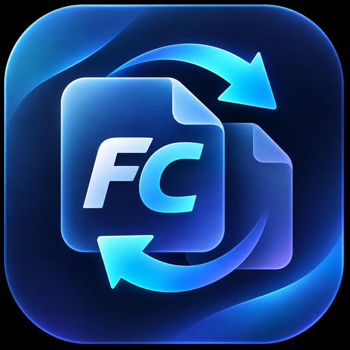
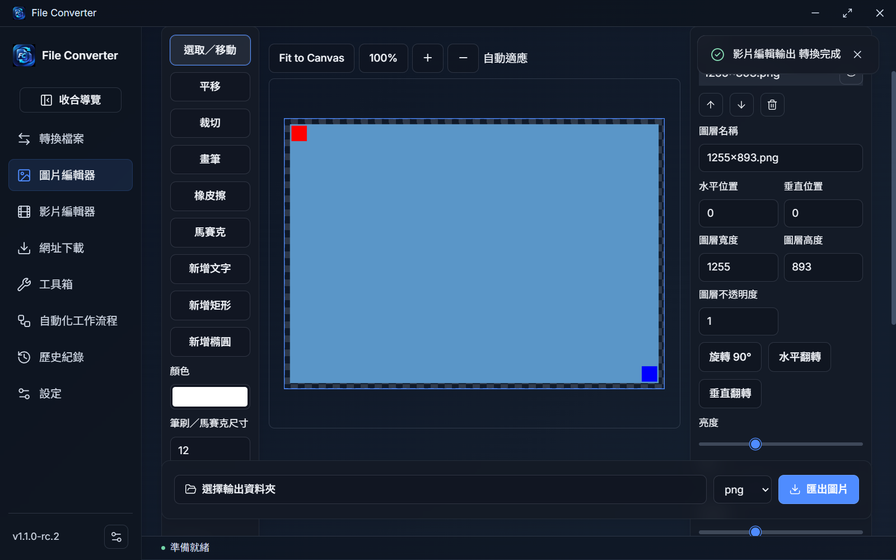

<p align="center">
  
</p>

<h1 align="center">File Converter</h1>

<p align="center">
  <strong>轉檔、剪片、修圖、下載影片，一個工具完成。</strong>
</p>

<p align="center">
  Windows 桌面應用程式 · 繁體中文介面 · 本機檔案處理 · 可自訂外觀
</p>

<p align="center">
  <a href="docs/FORMATS.md">支援格式</a> ·
  <a href="docs/REPAIRS_RC2.md">驗收報告</a> ·
  <a href="docs/DEPENDENCIES.md">開發與依賴</a>
</p>

> **目前版本：1.1.0-rc.3（Prerelease）**
> [下載安裝版與 Portable](https://github.com/chenyokuo/FileConverter/releases/tag/v1.1.0-rc.3) · [更新與發布說明](docs/UPDATES.md)

## 為什麼做 File Converter？

轉換 PDF 要開一個網站、剪影片又得換一個軟體，偶爾還遇到檔案大小限制。File Converter 把常用的檔案轉換與多媒體工具集中到同一個 Windows 桌面程式，讓你直接處理自己的檔案，不必先上傳到線上轉檔服務。

一般轉檔、剪輯與圖片處理在本機執行；**網址解析、影音下載及選用的更新檢查／下載需要連線**。安裝版與 Portable 版均內含必要的轉檔引擎，使用者不用另外安裝 Python、FFmpeg 或 LibreOffice。

## 核心功能

| 功能 | 你可以做什麼 |
| --- | --- |
| **萬用轉檔** | 自動辨識檔案類型、批次佇列、品質設定、取消／重試、轉檔歷史 |
| **影片編輯器** | 多軌時間軸、裁切／分割／插入、影音分軌、混音、字幕、文字、轉場、畫中畫 |
| **圖片編輯器** | 多圖層、裁切、調色、濾鏡、畫筆、橡皮擦、馬賽克、文字與形狀 |
| **網址下載** | yt-dlp 影片／音訊下載、畫質選擇、字幕、時間軸選段、多區間輸出 |
| **PDF 與 Office** | Office → PDF、PDF 頁面處理、圖片與 PDF 互轉、繁中／英文 OCR |
| **進階工具** | 音訊擷取、影片合併、電子書與壓縮檔工具、Windows 右鍵轉檔、自動化流程 |

目前已對 **305 個直接轉換方向**進行實際轉換與內容檢查。並非任意兩種格式都能互轉；各來源可用的輸出格式請見 [格式相容清單](docs/FORMATS.md)。

## 介面預覽

### 🎬 影片編輯器

匯入含聲音的影片後，會自動建立連動的 **V1 影片軌**與 **A1 原始音軌**，並顯示音訊波形。你可以在時間軸上拖曳、分割、裁切，或解除連動來單獨編輯音訊。

支援加入背景音樂、SRT 字幕、文字與畫中畫；編輯專案可儲存後繼續修改，最後交由 FFmpeg 匯出。

<p align="center">
  
</p>

### ⬇️ 影片下載與選段

貼上網址後選擇畫質與格式，直接拖曳時間軸兩端的把手，決定要保留哪一段。可下載完整影片、指定區間或多個片段，並將下載結果送入影片編輯器。

遇到無法直接播放的來源，可選擇**本機預覽備援**；此功能會先取得低畫質完整影片並轉碼，因此需要額外下載時間。實際可用性依來源網站而定。

<p align="center">
  
</p>

### 🖼️ 圖片編輯器

圖片載入後自動適應工作區，支援 Fit、100%、縮放與平移。可使用多圖層、畫筆、濾鏡、文字與形狀進行編輯，並輸出 PNG、JPG 或 WebP。

預覽縮放與實際圖片解析度分開處理，不會因畫面縮小就改變匯出尺寸。

<p align="center">
  
</p>

> 上述畫面均取自 **1.1.0-rc.2 的 Windows 原生程式測試**，不是概念圖。

## 安裝與使用

請至 [GitHub Releases](https://github.com/chenyokuo/FileConverter/releases) 下載 Installer 或 Portable ZIP，並用同版 `SHA256SUMS.txt` 核對檔案。RC 版標為 Prerelease，不會被 GitHub 的「Latest」正式版入口包含。大型 Runtime 與安裝包存放在 Release 附件，不提交進 Git 原始碼。

| 版本 | 使用方式 |
| --- | --- |
| **Installer** | 執行 `FileConverter_1.1.0-rc.3_x64-setup.exe`，依畫面完成安裝 |
| **Portable** | 將 `FileConverter-1.1.0-rc.3-windows-x64-portable.zip` 完整解壓，開啟其中的 `FileConverter.exe` |

**Portable 必須保留整個解壓資料夾**，不能只複製 `FileConverter.exe`；它需要同目錄的引擎、Sidecar、WebView2 與其他資源。

### 快速開始

1. **轉換檔案**：拖入檔案 → 選擇支援的輸出格式 → 設定輸出位置 → 開始轉換。
2. **剪輯影片**：開啟「影片編輯器」→ 加入素材 → 在時間軸上剪輯 → 儲存專案或匯出影片。
3. **編輯圖片**：開啟「圖片編輯器」→ 匯入圖片 → 編輯圖層與效果 → 匯出圖片。
4. **下載片段**：開啟「網址下載」→ 貼上網址 → 選取時間區間 → 設定格式並下載。

影片專案使用 `.fcvideo.json`，圖片專案使用 `.fcimage.json`。專案內保存素材路徑；要在其他電腦繼續編輯時，也需一併保留原始素材。

## 你可以自訂的外觀

File Converter 支援深色／淺色／跟隨系統主題，也能匯入自己的背景圖片，分開調整背景與玻璃面板的透明度、模糊、亮度及強調色。偏好設定與轉檔歷史會保存在本機。

Windows 右鍵入口可於設定中選擇啟用，Windows 11 可能需透過「顯示其他選項」開啟傳統選單。

## 軟體更新

在「設定 → 軟體更新」按下「檢查更新」，可查看最新版本與更新說明，並選擇「啟動時檢查」、「自動下載」及 Installer 的「自動安裝」。這些自動選項預設關閉，保持離線使用方式。

正式通道只取得正式版；候選通道同時接受較新的 RC 與正式版。下載顯示實際位元組進度，完成後經 Tauri 簽章及簽署版本驗證。Installer 交由 NSIS 更新並重啟；有轉檔、下載、預覽或匯出任務時會等待，啟用中的監看資料夾須先暫停。請在允許自動安裝前儲存編輯專案。

Portable 可檢查及下載經簽章驗證的新版 ZIP，請完整解壓到新資料夾。兩種版本均沿用 `%APPDATA%\studio.rai.converter` 保存設定及歷史。**rc.2 及更早版本首次需要手動安裝 rc.3**，才能使用之後的內建更新；不會替舊 EXE 憑空加入 Updater。

## 開發與建置

技術架構：**Tauri 2 + React + TypeScript + Rust + Python Sidecar**。前端負責互動介面，Rust 管理權限與桌面生命週期，Python 串接本機轉檔引擎。

開發環境需具備 Windows x64、Node.js／npm、Python 3.13 x64、Rust MSVC、Visual Studio C++ Build Tools 與 Windows SDK。

```powershell
# 取得原始碼後，在專案根目錄執行
powershell -ExecutionPolicy Bypass -File scripts/setup.ps1

# 啟動桌面開發模式
npm run desktop
```

由具備發布權限及原始簽章私鑰的維護者，從乾淨且已推送的 `main` 建立發行候選：

```powershell
powershell -ExecutionPolicy Bypass -File scripts/publish-release.ps1 -Version 1.1.0-rc.3
```

依賴準備腳本會依鎖定清單取得、校驗並部署所需 Runtime。建置流程產生 Installer／Portable；**原始碼不包含 22,000 多個大型 Runtime 檔案**，因此不能只 Clone 後直接啟動未準備的執行檔。

發布腳本沿用 `build.ps1`，產生簽章、`latest.json` 與 SHA-256，建立版本 Tag，先上傳草稿附件，再公開為 Prerelease／正式版。更新不需額外伺服器或應用程式內的 GitHub Token。金鑰備份、接續中斷上傳及測試方式見 [更新系統文件](docs/UPDATES.md)。

更多技術資料：

- [支援格式與轉換方向](docs/FORMATS.md)
- [依賴、下載來源與重建流程](docs/DEPENDENCIES.md)
- [1.1.0-rc.2 修復與測試報告](docs/REPAIRS_RC2.md)
- [散布與第三方授權注意事項](docs/DISTRIBUTION.md)
- [第三方套件聲明](THIRD_PARTY_NOTICES.md)

## 版本狀態與限制

`1.1.0-rc.2` 已完成同機 Installer／Portable 測試，包括 **305/305 格式方向**、**23/23 原生 GUI 測試**，以及影片畫面與聲音、圖片尺寸與透明度等實際內容驗證。完整證據與測試邊界請查閱 [驗收報告](docs/REPAIRS_RC2.md)。

rc.3 只修改更新與發布流程，相關驗收另見 [更新系統文件](docs/UPDATES.md)，沒有為文件或更新功能重跑 305 格式矩陣。**Tauri 更新簽章不等於 Windows Authenticode 簽章**；目前沒有 Authenticode 憑證。乾淨 Windows、Windows 10、實體多螢幕 DPI 與部分 NVIDIA／Intel 硬體尚待驗證；來源網站可能限制影音預覽或下載。

## 授權

應用程式採用 **AGPL-3.0-or-later**；內建的 FFmpeg、LibreOffice、Calibre、Ghostscript 等第三方元件各自適用不同授權。

對外散布前仍需完成相應原始碼與授權材料的交付。詳見 [LICENSE](LICENSE)、[THIRD_PARTY_NOTICES.md](THIRD_PARTY_NOTICES.md) 與 [散布說明](docs/DISTRIBUTION.md)。
