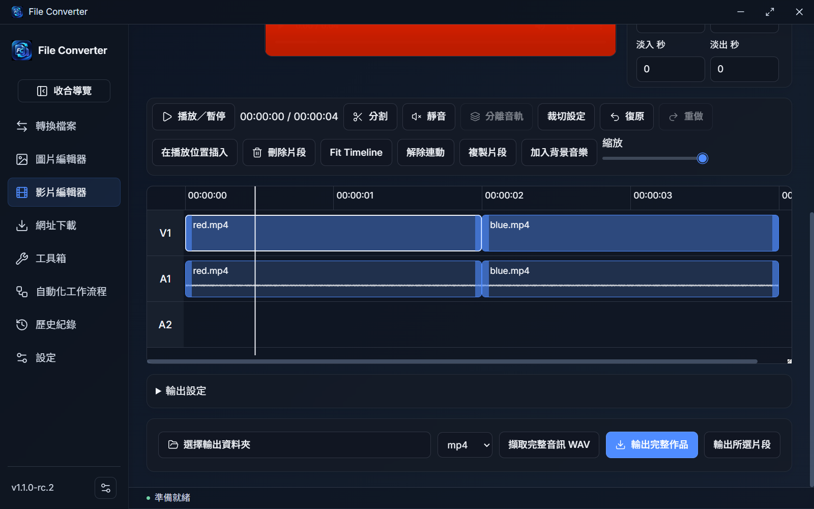
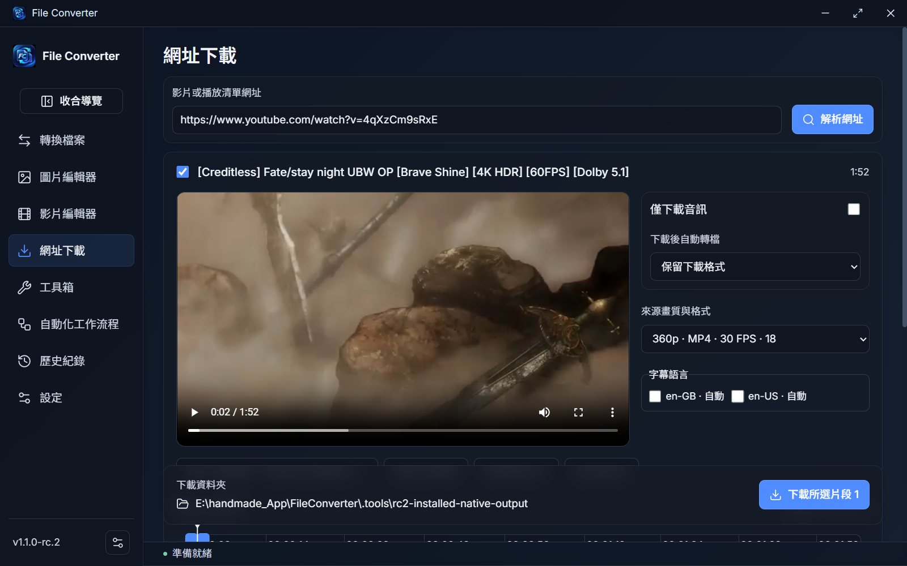

<p align="center">
  
</p>

# File Converter

**為 Windows 打造的本機轉檔與多媒體編輯工具。**

把影片、音訊、圖片、PDF 和 Office 文件的日常處理集中在同一個桌面應用程式。拖入檔案即可批次轉換，也能剪輯影片、編輯多圖層圖片，或將下載的片段接著送入編輯器，減少在不同工具之間切換。

介面採用繁體中文與可自訂的玻璃材質設計。背景圖片可以保持清晰，面板透明度、模糊與強調色各自調整；外觀設定、轉檔歷史和編輯專案都能保存。

**Windows x64 · 本機離線處理 · 批次轉檔 · 影片／圖片編輯 · 自訂外觀**

目前版本為 **1.1.0-rc.2 候選版**，以 Windows 11 x64 為主要驗證平台。檔案轉換與編輯在本機執行，不上傳使用者檔案；選用的網址下載功能需要網路。完整測試範圍與待驗項目見 [驗收報告](docs/REPAIRS_RC2.md)。

## 可以用它做什麼？

| 工作 | 主要能力 |
|---|---|
| 批次轉檔 | 自動辨識來源、混合格式佇列、品質設定、真實進度、取消、重試與歷史紀錄 |
| 影片與音訊 | 格式轉換、音訊擷取、裁切與合併、字幕、影格擷取、音量標準化及 GPU／CPU 編碼 |
| 圖片 | JPG／PNG／WebP／HEIC／AVIF 等格式轉換、調整尺寸、壓縮、透明度與多圖層編輯 |
| PDF 與 Office | 文件轉 PDF、PDF 頁面操作、圖片與 PDF 互轉、繁中／英文 OCR、浮水印與密碼工具 |
| 電子書、向量與壓縮檔 | 電子書轉換、向量格式處理、ZIP／7Z／TAR／GZ，以及 RAR 解壓 |
| 網址影片 | 來源格式與畫質選擇、播放清單、字幕、完整或指定區間下載、多片段輸出 |
| 重複工作 | 儲存轉檔預設、建立多步驟流程、明確啟用的監看資料夾與選用 Windows 右鍵入口 |

支援 **305 個經實際轉換與內容檢查的直接格式方向**。可用輸出依來源格式決定；完整清單與適用範圍見 [格式相容矩陣](docs/FORMATS.md)。

## 影片編輯：畫面與音訊分軌操作

匯入含音訊的影片後，會自動建立連動的 V1 畫面與 A1 原音，A2 可加入背景音樂。時間軸顯示實際波形，支援拖曳、裁切、分割、插入及合併；需要單獨調整音軌時，可解除連動。

- 調整速度、音量、靜音、淡入淡出與交叉溶解。
- 加入文字、SRT 字幕和畫中畫。
- Undo／Redo、Fit Timeline，以及可再次開啟的非破壞性專案。
- 預覽與匯出共用時間軸合成規則，透過 FFmpeg 產生實際成片。



## 圖片編輯：完整預覽，保留輸出解析度

圖片匯入後會依工作區自動置中與縮放。可隨時切換 Fit、100%、滾輪縮放和平移，預覽縮放不會改變實際輸出尺寸。

- 多圖層選取、移動、排序、隱藏與不透明度調整。
- 裁切、旋轉、翻轉、亮度、對比、飽和度與濾鏡。
- 畫筆、橡皮擦、馬賽克、文字、形狀與其他圖片圖層。
- 保存編輯專案，輸出 PNG／JPG／WebP；支援格式保留 Alpha 透明通道。


## 網址下載：預覽後選取需要的片段

解析網址後，可選擇實際來源畫質、格式與字幕，使用時間軸雙端把手或起訖時間欄位設定區間。支援完整下載、單段、多段、快速／精確裁切及片段合併，下載完成後可直接送入影片編輯器。

若來源串流無法直接播放，可以建立可取消的本機預覽。這個操作會下載低畫質完整影片，再提供播放、暫停及跳轉；預覽失敗仍可操作已知長度的選段控制。網站支援情況受來源政策與網路限制影響，不提供 DRM、登入或 Cookie 繞過。



以上三張皆為 **1.1.0-rc.2 實際 Windows Tauri／WebView2 應用程式的驗收截圖**；圖片與紅／藍影片是自製測試素材，網址頁為使用者指定來源的實測畫面。

## 依照你的桌面調整外觀

匯入自己的 JPG／PNG／WebP 背景，或選用純色、漸層與預設背景。背景縮放、位置、亮度、不透明度、模糊及暗色遮罩分開控制，玻璃面板也有獨立設定，不會連帶降低文字和按鈕的透明度。

提供「清晰背景」（Blur = 0）與「毛玻璃背景」配置、深色／淺色／跟隨系統、自訂強調色及外觀預設保存。調整即時預覽，關閉後仍保留；介面支援減少動態效果。

## 安裝與快速上手

候選交付包含 Windows Installer 與 Portable ZIP。原始碼儲存庫不包含大型 Runtime 或編譯產物；從原始碼使用時，請依下方開發與建置流程準備。

| 方式 | 操作 |
|---|---|
| Installer | 執行 `File Converter_1.1.0-rc.2_x64-setup.exe`，依安裝程式完成設定 |
| Portable | 將 `FileConverter-1.1.0-rc.2-windows-x64-portable.zip` **完整解壓**，啟動其中的 `FileConverter.exe` |

候選包已包含 Python Sidecar、FFmpeg、LibreOffice、Pandoc、Calibre、Ghostscript、7-Zip、OCR 模型、Deno 與固定版 WebView2，無須另行安裝這些轉檔引擎。Portable 請保留 `binaries/`、`engines/`、`webview-runtime/` 和授權檔，不能只複製 EXE。交付檔案可用隨附 SHA-256 清單核對。

### 第一次轉檔

1. 在「轉換檔案」拖入或選擇一個以上的檔案。
2. 選擇該來源支援的輸出格式，調整品質與其他選項。
3. 指定輸出資料夾，開始轉換。
4. 在佇列查看個別進度、錯誤或結果，也可從歷史紀錄重新執行。

影片編輯：匯入素材 → 移動、裁切或分割 → 調整效果 → 儲存 `.fcvideo.json` → 匯出影片。圖片編輯：開啟圖片／加入圖層 → 編輯 → 儲存 `.fcimage.json` → 匯出圖片或加入轉檔佇列。專案記錄素材路徑，重新開啟時需保留來源素材可用。

### 資料與系統整合

原始檔不直接覆蓋，輸出撞名會另存。設定、背景與歷史保存在 `%APPDATA%\studio.rai.converter`，沿用既有資料識別碼；Portable 也使用這個位置。密碼僅暫存在記憶體，重試需重新輸入。

監看資料夾只處理使用者明確指定位置的直接子檔案，來源與輸出不可重疊，重開程式後需重新啟用。Windows 右鍵入口在「設定 → 進階」選用，不變更預設開啟程式或檔案關聯；移動 Portable 目錄前請先停用。Windows 11 可於「顯示其他選項」查看。

## 版本狀態與使用範圍

1.1.0-rc.2 已在本輪實際驗證 Installer、解壓後的 Portable、305 格式方向、23 組原生 GUI，以及影片聲音／畫面、圖片尺寸／像素／Alpha。詳細範圍與結果見 [修復及驗收報告](docs/REPAIRS_RC2.md)。

候選版尚未簽章；乾淨 Windows、Windows 10、實體多螢幕 DPI 與其他 GPU 仍待外部實機驗收。硬體加速會實際探測，不可用時提供 CPU 備援。網址下載可能受網站限制；PDF→DOCX／OCR 結果需校對，像素修補不能還原原始畫面，有損壓縮也不保證指定檔案大小。

影片編輯後會重新合成預覽，較長作品可能需要等待。完整散布與授權要求見 [散布說明](docs/DISTRIBUTION.md)。

## 架構與目錄

Tauri 2.12.5 + React 19.3.1 + TypeScript 7 + Vite 8 + Tailwind 4，Radix、Motion、Lucide。Rust 白名單 IPC→凍結 Python JSONL 服務→隔離 worker→本機引擎。沒有前端任意 Shell、CDN 字型、雲端轉檔或自建追蹤服務。

```text
src/                React GUI、玻璃、背景、轉檔／下載／工具／自動化
src-tauri/          Rust bridge、權限、圖示、NSIS 專屬清理 hooks
engine/             Registry、內容辨識、adapters、工具與佇列
scripts/            SHA 校驗依賴取得、Runtime staging、freeze、授權與封裝
tests/              真實內容、生命週期、格式矩陣與原生 CDP 驗收
docs/               格式表、階段紀錄、驗收、授權與限制
engine-lock.json    Runtime／模型／字型／WebView2 來源和 SHA-256
```

## 開發

開發機需 Node.js/npm、Rust MSVC、VS C++ Build Tools、Python 3.13 x64；使用者不需要。7-Zip 由校驗腳本準備，不依賴系統安裝。完整來源、SHA-256、架構與目的地見 [DEPENDENCIES](docs/DEPENDENCIES.md)。

```powershell
powershell -ExecutionPolicy Bypass -File scripts\setup-dependencies.ps1
npm run desktop
```

```powershell
npx tsc --noEmit
cargo check --manifest-path src-tauri/Cargo.toml
.venv\Scripts\python.exe -X utf8 -m unittest discover -s tests -p 'test_*.py' -v
.venv\Scripts\python.exe -X utf8 tests\matrix.py
```

P1–P4 只跑相關簡測和增量編譯。`tests/matrix.py --failed` 重試未通過方向。素材在忽略的 `.tools/` 產生，不提交私人檔案。`tests/native-ui.mjs` 連接真正 WebView2 的 localhost CDP，僅控制測試檔案選擇結果。`scripts/test-packaged.ps1 -InstallRoot <候選目錄> -Test tests/native-editors.mjs -Label portable` 使用隨包 Fixed WebView2 與只含 Windows 的子程序 PATH，檢查真正編輯／輸出及正常關閉；執行前應先關閉自己的 File Converter。另可用 `tests/production-start.py <候選目錄>` 驗證不開 CDP 的一般啟動。這些測試使用本專案自製 fixtures，需先完成相對應功能測試。

原生驗收前以 `.venv\Scripts\python.exe -X utf8 tests\make_packaged_fixtures.py` 從程式產生小型圖片、紅／藍影片、Office 文件與繁中掃描 PDF；不需下載／提交大型測試檔。元件互動測試需先啟動 `npm run dev`，再分別執行 `node tests/video-editor-ui.mjs`、`node tests/image-editor-ui.mjs`、`node tests/editor-integration-ui.mjs`。

## P5 EXE／Installer／Portable

```powershell
powershell -ExecutionPolicy Bypass -File scripts\build.ps1
```

重用已校驗 Runtime，產生 PyInstaller onedir、Tauri Release／NSIS、Portable ZIP 與 SHA256SUMS。只有已完成相同 P5 回歸的工作可用 `-SkipTests` 避免重跑；`-NoInstaller` 供必要的局部修復建置。接著執行 `scripts\verify_release.py`、原生 GUI 與安裝驗證。沒有憑證時為未簽署候選版。

## 授權

應用程式 AGPL-3.0-or-later；引擎含 GPL/AGPL/LGPL/MPL、7-Zip unRAR 限制與 Microsoft Runtime 條款。保留 [完整說明](THIRD_PARTY_NOTICES.md) 和套件 notices。私人儲存庫不免除向二進位收件者提供相應原始碼的義務；候選包尚非對外散布認證版本。
