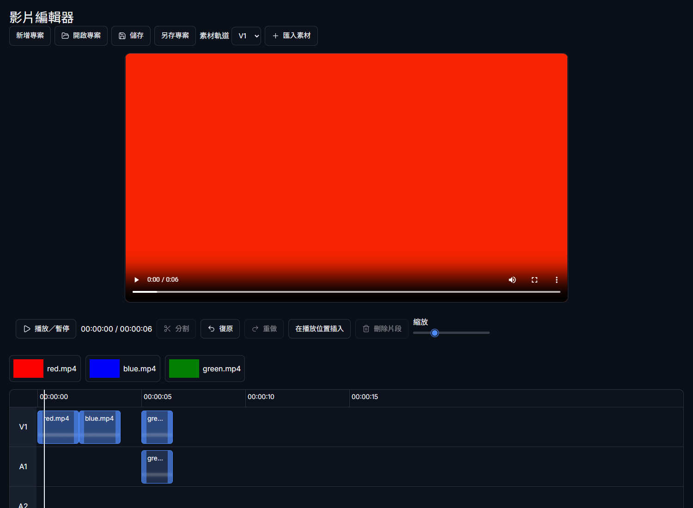

# Multimedia P1 — 影片編輯器

2026-11-17。獨立影片編輯頁；上方 16:9 預覽、中間工具列、下方 V1/A1/A2 與可擴充 V2 軌道。沿用既有主題／字型／按鈕。無新動畫或多媒體套件；HTML video + Pointer Events 提供底層操作，FFmpeg 負責實際合成。

- 非破壞性 fcvideo v1 JSON；片段分開保存來源 in/out、專案 at、速度、靜音／音量、淡入淡出、轉場及 PIP。標題、SRT、尺寸、FPS、輸出參數一併保存。遺失素材明確列出，選取片段可重新定位。
- 真實匯入、素材拖入軌道、片段移動與左右 Trim、Split、在指標插入、刪除、縮放、Seek、Undo/Redo、分離音軌、完整作品音訊擷取、A2 音樂／混音、變速、淡入淡出、交叉溶解、文字、SRT 與 V2 畫中畫。
- 同一份驗證後時間軸渲染預覽和匯出。編輯後會取消過期預覽並重新合成；更新時暫停播放，避免拿舊畫面冒充新編輯。長作品重新合成會花時間，目前不是逐幀 GPU 即時效果引擎。
- 合成先統一尺寸、FPS、音訊格式，保留黑色空白區間。交叉溶解必須明確設定相符的重疊長度；一般同軌重疊會報錯。CPU 合成後沿用現有硬體編碼與 CPU fallback 輸出 MP4/MKV/MOV/WebM；不宣稱 CPU 合成是 GPU 特效。
- 預覽檔只透過 Tauri 官方 asset protocol 開放本程式 APPDATA/previews；未開放任意本機檔案。增加的 Rust 間接依賴 http-range 0.1.6 已鎖入 Cargo.lock；其 MIT 授權隨最終清單彙整。

簡測：`test_video_editor.py` 3 組真實引擎測試通過，驗證三種尺寸影片、分割／速度／空白區間的像素及時長、音軌分離／混音、轉場中間畫面、PIP、繁中標題／SRT、MP4/MKV/WebM/WAV、專案重開／遺失素材、原始檔 SHA 不變。`video-editor-ui.mjs` 以真實 Python service + 本機測試傳輸（僅原生檔案選擇器提供測試路徑）驗證匯入三段、拖曳 Trim/移動、Undo/Redo、分離 A1、儲存重開、實際預覽播放及匯出；沒有 mock engine 或 mock jobs。`tsc --noEmit`、Tauri 增量 cargo check 通過。未打包 Installer/Portable。

