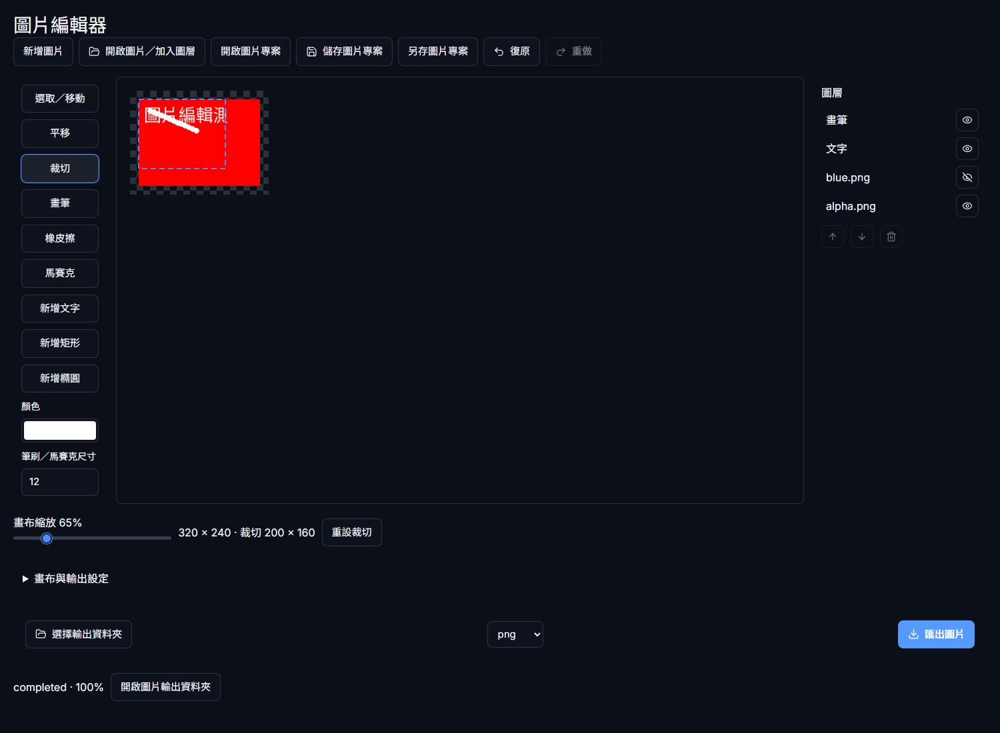

# Multimedia P3 — 圖片編輯器

2026-11-17。左側工具、中央可縮放／平移畫布、右側圖層與參數、上方專案存取與 Undo/Redo、下方輸出。保持既有主題變數、字型與按鈕。

使用自訂 SVG 互動畫布與既有 Pillow 合成器，未新增 Fabric.js／另一套大型框架。選擇原因：需求限定的圖片、形狀、文字、筆畫與區域效果均有明確、版本化的 fcimage v1 圖層模型，預覽與全解析度匯出共用 Pillow 邏輯，避免瀏覽器與 Python 濾鏡結果不一致。SVG 僅提供選取、拖曳、畫筆、區域選取與縮放介面；真正輸出不是把低解析度 UI 截圖另存。

已實作：畫布裁切、圖層縮放／移動、旋轉／翻轉、亮度／對比／飽和度／色溫、黑白／復古、模糊／銳化、自由畫筆、透明橡皮擦、區域馬賽克、文字／矩形／橢圓／圖片圖層、排序／隱藏／選取、Undo/Redo、平移／縮放、版本化專案存讀、遺失圖片重新定位、PNG/JPG/WebP。橡皮擦是非破壞性效果層，清除其下方合成結果；馬賽克也是依順序作用於下方圖層。JPG 以 matte 合成；PNG/WebP 保留 Alpha。匯出使用 crop/outputWidth/outputHeight 的實際尺寸，預覽縮圖不限制匯出解析度。

`test_image_editor.py` 4 組真實引擎測試通過：圖層像素、順序／隱藏／Alpha、裁切後三種格式尺寸、旋轉／濾鏡／文字／筆畫／橡皮擦、馬賽克區域的實際像素變化、專案重開位元組一致、來源 SHA 不變與禁止覆寫非專案檔。

`image-editor-ui.mjs` 真實 Python 引擎互動通過：匯入／文字／第二圖片、圖層順序和隱藏、滑鼠畫筆與裁切、Undo/Redo、專案存讀、真正 200×160 RGBA PNG。每次使用新測試資料庫，防止誤取上次完成任務。TypeScript 檢查通過。未打包 Installer/Portable。

