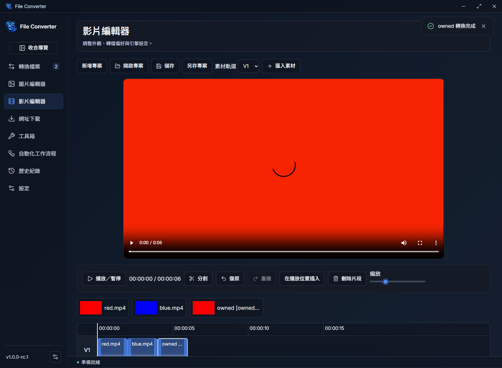

# Multimedia P4 — 跨工具整合

2026-11-17。下載頁顯示真實工作與成果，完成後可直接送入影片編輯器。歷史和轉檔清單也提供對應的影片／圖片編輯入口；影片編輯器接受 Windows 檔案選取及原生拖放。圖片匯出完成後可加入原有轉檔清單，再選格式執行原本的佇列。

影片、圖片、下載頁保持掛載，切頁保留時間軸、圖層、網址與範圍；影片／下載播放器離頁暫停，避免背景音訊。非同步素材讀取在提交時合併最新專案，不覆寫途中已做的編輯；Undo 同時讀取最新狀態。素材箱改用 Pointer Capture 拖入軌道，避免 Windows WebView 原生檔案拖放與 HTML5 drag/drop 衝突。

簡測 `editor-integration-ui.mjs` 通過：使用實際 App、真實 Python service、真正自有 HTTP 影片下載；替換的僅是測試 IPC 傳輸和原生 OS picker/window event。驗證 converter→video、image→queue、離頁暫停、切頁保留、原生拖入路由、download→video。沒有 fake engine／fake completion。

`video-editor-ui.mjs` 再驗證素材箱 Pointer 拖入 A2。`test_video_editor.py` 新增真正啟動 FFmpeg 合成後取消，確認子 PID 消失、工作狀態 cancelled、暫存 .rai-* 目錄清除。沒有重做全套回歸、沒有 P1–P4 安裝包。

