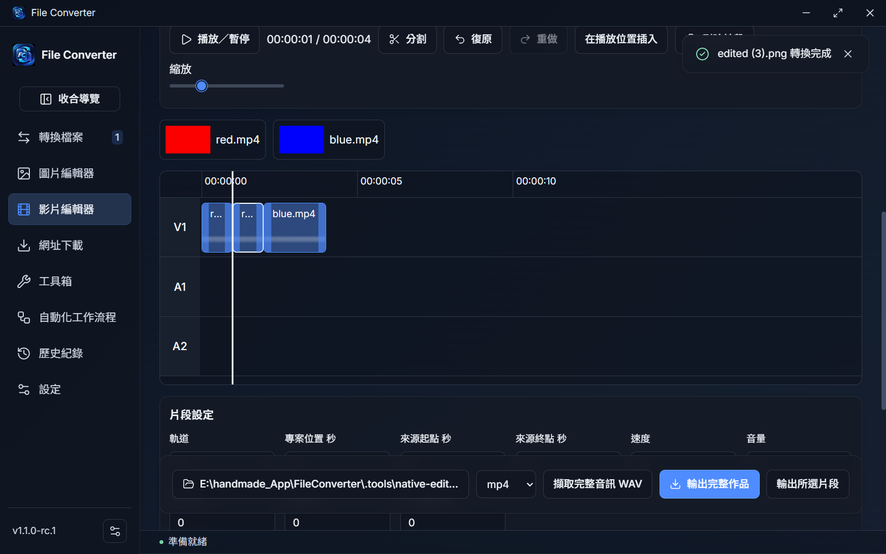
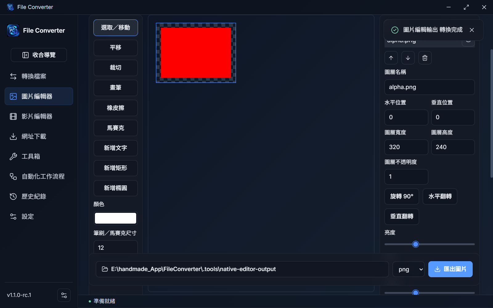

# Multimedia P5 — 1.1.0-rc.1

2026-11-17，本輪 P1/P3/P4 已完成相關簡測並提交；P2 保留並擴充真實網站驗證。沒有在 P1–P4 打包。

已完成完整來源回歸 68 項，67 通過、1 個 PE 資源項待最終實際 EXE/Installer 測試。其餘測試包含原有 PDF/OCR/Office/下載/檔案/自動化和新編輯器。305 格式矩陣本輪以新目錄執行，結果另記。

YouTube 真實網站：Big Buck Bunny 官方 Blender Foundation 來源成功解析 61 格式、635 秒，使用含音訊 360p format 18 精確下載 1–2.5 秒，FFprobe 輸出 1.509002 秒。未使用 Cookie/帳密或存取繞過。第一次最佳分離來源曾無進度，修正 app-local FFmpeg 網路讀取逾時和已含音訊格式不重複追加音訊後通過；不保證所有網站／地區／帳號限制均可下載。

完整 Runtime 準備腳本已實際執行並校驗既有快取；新增新目錄 Git 來源還原與無 AI 的乾淨 venv、npm/Cargo 重建驗證，進度與最終結果將追加於本文件。最終來源 hash、產物 hash、真正執行檔／Installer 結果另列，不能用開發模式測試代替。

依然沒有乾淨 Windows VM／第二台實機，這項限制不會被新目錄測試取代。保留原有 1.0.0-rc.1，沒有刪舊版、Force Push 或自動建立 GitHub Release。相應來源散布與未簽署限制見 DISTRIBUTION.md。

乾淨來源驗證結果：從不含 vendor/venv/node_modules/sidecar 的 Git export 實際還原全部 Runtime，重新安裝 hash-locked Python 和 npm 依賴，重用 SDK/下載快取；重要引擎雜湊、40 個 Python 版本及無 AI 模組檢查通過。官方 PyMuPDF wheel 內含可選 layout/LLM 目錄，初次檢查正確阻擋；加入僅作用於 setup 自有新 venv 的經保護裁減後，整個命令重跑成功。該新環境中 8 組編輯器實際輸出與 3 組 PDF/OCR/Office 流程亦通過。不是複製原本 venv/vendor 冒充重建；重用的是已驗證來源 archive/wheels/npm/Cargo 快取。Cargo target 透過 workspace 內接合重用編譯快取，避免重編所有 Rust 相依套件。

本輪格式矩陣 305/305 通過；下載器網站修正後只重測相關 8 組案例，全部通過。Appearance 預設／遷移／持久化設定檢查通過。真正 YouTube 檢查已通過，仍保留網站限制說明。

真正 Tauri Debug/WebView2/Rust/Python 原生驗證通過：修正 `$APPDATA` 已包含應用識別碼導致預覽 ACL 多一層的問題，僅開放 `$APPDATA/previews/**`；原生影片播放、圖片預覽、兩種編輯輸出、圖片→轉檔、跨頁狀態、最大化／還原均通過。新增 Windows 根 Job 管理 Python redirector 與整個側車程序樹，原生視窗正常退出，不把測試 picker 誤當 engine mock。測試只替換 OS picker 回傳路徑，所有引擎與 IPC 真實。

正式來源程式版本為 1.1.0-rc.1。以下為本輪集中封裝及原生驗證的更新紀錄，先前的「待測」均以此處最終結果與限制為準。

## 功能與輸出驗證

| 階段 | 實際結果 |
|---|---|
| P1 影片 | V1/A1/A2/V2、Pointer 拖放／排序／Trim／Split、指標插入與合併、分離／靜音／音訊擷取、音樂混音、速度、淡入淡出／溶解、繁中標題／SRT／畫中畫、Undo/Redo、專案存讀／重新定位。4 組後端測試驗證時長、像素、聲音、轉場、來源 SHA 和真正取消 FFmpeg PID；原生 GUI 分割兩段為三段後匯出含影音串流的 4 秒 MP4 |
| P2 下載 | 保留現有同步播放器、範圍把手／時間輸入、完整／多片段、快速／精確、分段／合併。真正網站以來源 API 及 shipping frozen Sidecar 分別測試，均得到 1.509002 秒片段；沒有 Cookie／帳密或存取繞過 |
| P3 圖片 | SVG 互動畫布與共用 Pillow：裁切、旋轉／翻轉／縮放、亮度／對比／飽和度／濾鏡、筆畫／透明橡皮擦／馬賽克、文字／形狀／圖片、多圖層排序／隱藏／選取、Undo/Redo、專案存讀、PNG/JPG/WebP。4 組後端驗證實際像素與專案往返；元件輸出 200×160 RGBA，原生輸出 320×240 RGBA PNG／WebP |
| P4 整合 | 真正下載成果→影片、轉檔／歷史→對應編輯器、原生拖入路由、圖片成果→原轉檔佇列，切頁保留狀態及暫停背景播放。自有 HTTP／真實 Python 整合與原生 IPC 均通過 |

影片預覽與匯出採同一份驗證後時間軸；編輯後非同步重新合成，長作品需要等待。目前不是逐幀 GPU 即時特效引擎。CPU 合成後沿用既有 GPU 編碼探測／CPU fallback，不把 GPU 編碼冒充 GPU 合成。

## P5 整合驗證

| 驗證 | 結果 |
|---|---|
| 完整來源回歸 | 68 項，67 通過、1 個 PE 項當時等待真正 EXE／Installer；PE 三目標另行實測，沒有把 skip 當通過 |
| 真實格式矩陣 | 本輪新目錄 305/305；逐類解碼／內文／頁面／解壓驗證 |
| 新 frozen Runtime | 封裝前 11 組圖片／影片／OCR 通過，另有僅 Windows PATH 的 9 組原有引擎功能通過 |
| 新編輯器編碼整合 | 同機 shipping Sidecar：CPU libx264、AMD h264_amf 實際輸出；NVIDIA／Intel 探測不可用，兩者明確回報並退回 libx264，各輸出 1 秒可讀影片。這不代表實體 NVIDIA／Intel 已驗收 |
| 既有原生 GUI | packaged WebView2／Rust／Python 23/23 組通過：外觀、六材質、佇列、轉檔、歷史、視窗、工作流程、預設、預覽與參數；測試期間沒有外部網路請求 |
| 編輯原生 GUI | 媒體 asset protocol、播放／Seek／Split／匯出、圖片→佇列、切頁狀態、最大化／還原，760／960／1280／1500px 編輯頁無水平溢出 |
| DPI | 首頁常見桌面尺寸及 125/150/200% renderer 模擬通過，與實體 Windows OS DPI 驗收明確區分 |
| 資料保護 | 自製素材；僅清除測試工作，還原背景／設定／自動化。安裝前後 SQLite 三表語意 SHA 一致 |

GUI 測試只提供 OS picker 的測試路徑；所有 IPC、引擎、工作狀態及輸出都是真實。舊測試原本假設只存在一個 `.conversion-toolbar`，因編輯頁保留掛載而改為選取可見工具列。測試另抓到真正窄版溢出：轉檔的編輯入口改為具完整可讀名稱／提示的圖示操作，編輯器輸出路徑可縮短顯示、工具列換行。修正後 23 組 GUI 與編輯器尺寸驗證通過。

## 封裝紀錄與來源

先由 `3e9507c` 集中建置。Portable 首次組裝遇 Windows 深路徑，僅修復 extended-path 複製及 ZIP；原生 GUI 發現實際溢出後，才重新編譯前端／EXE、更新 Installer／ZIP，沒有重抓或重新凍結 Python Runtime。最終產品程式碼為 `02e7d0f`，其後只補驗收腳本／文件／證據。Tailwind 明確只掃描 src，避免沒有 .git 的乾淨目錄掃入封裝內 Runtime。

最終檢查碼見 [multimedia-SHA256SUMS.json](validation/multimedia-SHA256SUMS.json)，包內容見 [multimedia-release-verification.json](validation/multimedia-release-verification.json)。Portable 全 CRC、22,183 個 Runtime manifest 項目存在、重要 EXE／模型／字型 SHA、Python 原生擴充及 Fixed WebView2 均納入。Installer 主 EXE 與 standalone 僅有 Tauri 三 bytes bundle marker 差異。主 EXE、Sidecar、Installer 的 16/20/24/32/40/48/64/96/128/256px 圖示逐像素比對通過；原圖未修改。

最終 Installer 實際安裝到獨立目錄後，影片／圖片編輯原生驗證、圖片→JPG、Office→PDF、繁中 OCR 通過；解除安裝後設定／歷史／自動化語意 SHA 與安裝前一致，自己的捷徑已移除。Portable 從最終 ZIP 真正解壓至 `release/FileConverter-1.1.0-rc.1-Portable`，再測相同編輯／原有引擎操作通過。兩套執行時 PATH 只含 Windows，使用包內 Fixed WebView2 157.0.4341.60、frozen Python 和 app-local 引擎；測後程序正常退出且無殘留 Sidecar。

另逐一解碼兩套原生輸出：4 秒影片包含影音串流，0.5 秒紅色／2.5 秒藍色畫面正確；PNG／WebP 為 320×240 RGBA 並保留透明角落；JPG 尺寸與來源一致；Office PDF 可讀到 `Matrix sentinel content 42`；OCR 產生可搜尋繁中，但把「繁體」辨為「繁髒」，需要校對。沒有只依賴 completed 狀態。一般啟動另移除 CDP 參數，以 Windows 主視窗正常關閉驗證成功，沒有殘留引擎。證據見 [輸出內容](validation/multimedia-packaged-content.json)、[一般啟動](validation/multimedia-production-start.json)、[解除安裝](validation/multimedia-uninstall.json)。

交付位於 `E:\handmade_App\FileConverter\release`；新的 Installer／ZIP 及解壓目錄使用獨立 1.1.0-rc.1 名稱，原 1.0.0-rc.1 全部保留。`SHA256SUMS.json` 合併新舊檢查碼，另有每版本檢查碼，沒有清除穩定版或舊 RC。

## 尚未通過的正式閘門

目前主機的 app-local Runtime 與 System-only PATH 不代表乾淨 Windows 已驗收；Windows 10、實體多螢幕／150/200% OS DPI、NVIDIA／Intel 實體 GPU 仍待測。使用者已確認沒有可用 VM／第二台實機，不重複要求同一項環境。

候選未簽署；外部 GPL/AGPL/LGPL 二進位的完整 corresponding-source 交付仍未彙整，私人 GitHub 或來源 URL 不取代收件者來源提供義務，見 [DISTRIBUTION](DISTRIBUTION.md)。YouTube 仍有網站／地區／帳號／格式限制。

因此不標示 P5「正式全面通過」、不刪除舊 1.0.0-rc.1、不建立正式發行 Tag／GitHub Release、不整合 main。來源與驗收候選分支可同步私人 Repository；保留外部閘門，不把同機測試冒充乾淨 Windows 認證。
