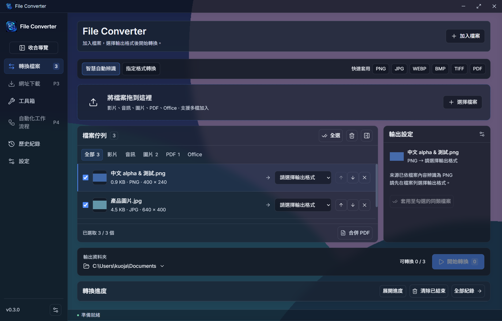
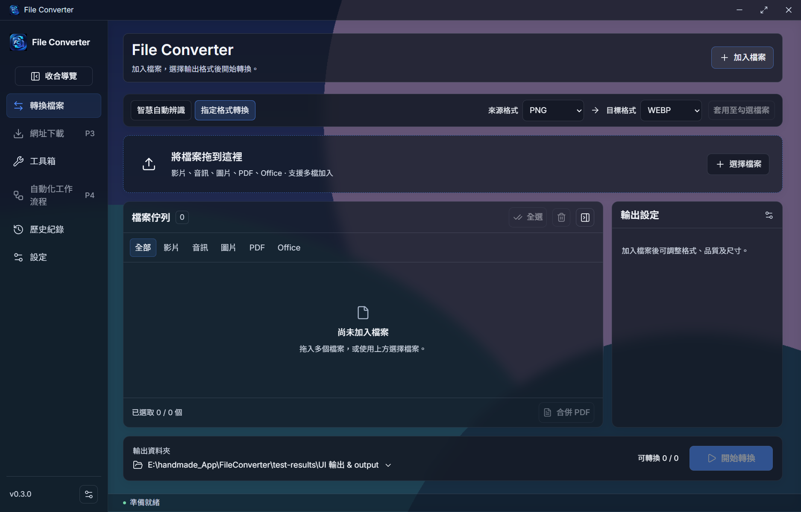
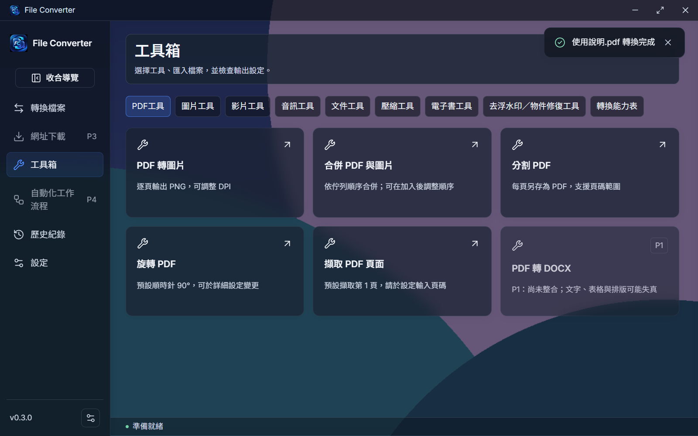
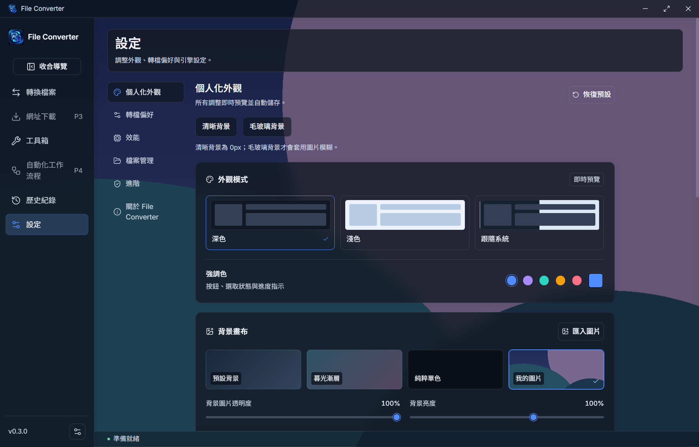
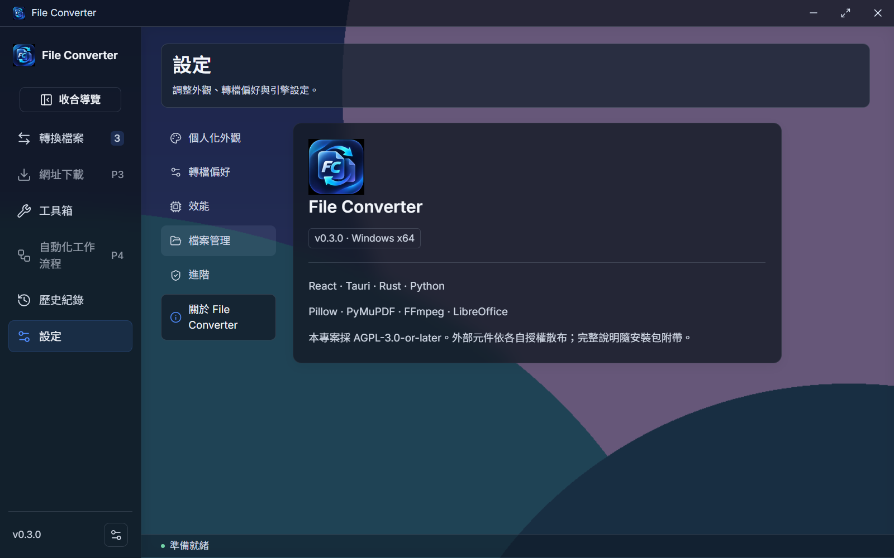

# P0 — File Converter 0.3.0

## 交付範圍

此版升級既有專案，保留影音／圖片／PDF／Office Adapter、SQLite 歷史、真實進度、佇列取消與外觀設定。開始前建立 `p0/application-refactor` 分支，以及 `checkpoint/pre-p0-v0.2.0` 回復點（`b576a41`）。本輪不 Push GitHub；最終整合驗收後才同步。

依最新流程，P0～P4 不逐次重建 Installer／Portable，完整封裝留到 P5。這輪因更新 Tauri 圖示與 Sidecar 封裝而產生的 P0 預覽包保留為驗證快照；後續只更新測試紀錄、原始碼與 Git Commit。

| 項目 | 修改前 | P0 |
|---|---|---|
| 導覽 | 轉檔、紀錄、設定 | 六項導覽、可保存的圖示模式；P3 網址下載與 P4 工作流程明確停用 |
| 匯入 | 以副檔名分類、自動指定目標 | 內容辨識；自動模式目標留空，指定模式檢查預期來源 |
| 格式能力 | 靜態後端函式 | Registry 統一 UI、工具箱與 worker 驗證；Graph 規劃直接／中介路徑 |
| 工具箱 | 無獨立工具頁 | 八類工具，實作工具接入現有佇列；尚未整合的功能顯示階段與原因 |
| PDF → PDF | 容易空操作 | 必須指定頁碼、旋轉、分割或多檔合併 |
| 圖示／名稱 | 舊品牌與 R 標記 | 指定原圖、File Converter、FileConverter.exe、完整 Windows ICO |
| 個人化 | v0.2 已提供清晰背景與分層玻璃 | 全部保留；主工作區永不套用全域 blur，清晰背景預設 0px |

## 實際操作

- **智慧自動辨識**：先匯入，再於每列指定輸出；快速格式只套用相容的勾選檔案。右側參數可批次套用至勾選的同類檔案。所有勾選項目都有效才開放開始轉換。
- **指定格式轉換**：先選來源 → 目標，再匯入。每個檔案依實際內容檢查來源；不符時顯示原因。取消勾選、重新套用正確來源／目標，或切回自動辨識即可處理。
- **工具箱**：PDF 轉圖、合併、分割、旋轉、頁碼擷取；圖片輸出與合併 PDF；影片 MP4／音軌擷取；音訊 MP3／WAV；Office → PDF（依賴 LibreOffice）。開啟工具後仍可於佇列調整設定／順序，再提交。
- **轉換能力表**：可搜尋來源、目標或 Adapter，查看引擎狀態、回歸案例覆蓋、可能損失與設定。未驗證的配對不冒充已實測。

P0 不提供 PDF → DOCX、壓縮、電子書、物件修復、網址下載與工作流程的模擬功能，分別標記 P1／P2／P3／P4。LibreOffice 仍是本機選用依賴；完整 Runtime 封裝與更多引擎屬 P1。

## 真實畫面

以下由 Windows WebView2 實際執行截取，並非設計稿。

v0.2 修改前畫面留於 [既有 UI 整改紀錄](UI_REWORK.md)，可由回復 Tag 重現；歷史截圖不屬於現行應用圖示資源。

## 圖示與資料相容

指定原圖複製至 `src-tauri/icons/source/file-converter-original.png`，原圖 SHA-256：`43ac05c2ceb7cd72bee21303c3ff6c1d6e905212eb3df3a1699fbc05d8b6ac77`。Downloads 原檔保持不變。Tauri Icon Generator 產生平台資源，`scripts/icons.py` 以 Lanczos 與等比例置中重建 Windows ICO（16／20／24／32／40／48／64／96／128／256）與所需 PNG 至 512px。側邊欄、標題列與 About 使用同源密度資產。

EXE、Python Sidecar、NSIS Installer／Uninstaller 均指定新圖示。桌面／開始功能表捷徑指向 FileConverter.exe，工作列與檔案總管讀取 EXE 的圖示資源。保留 `studio.rai.converter`、SQLite 與舊外觀儲存 key，不重設使用者資料。沒有新增檔案關聯，也不修改其他應用程式或全系統檔案類型圖示。

Windows 可能快取舊捷徑：請關閉舊版，從新版本 FileConverter.exe 啟動；若已釘選舊路徑，可自行取消釘選該程式後重新釘選。程式不清除全系統 icon cache、不重啟 Explorer、不改預設開啟程式。

## 驗證與限制

詳細實測結果見 [VALIDATION.md](VALIDATION.md)。自動化核對 ICO 各尺寸及 EXE／Installer 的實際 PE 圖示像素。125／150／200% 測試包括 renderer DPI 尺寸模擬，仍需多螢幕實機驗證 Windows Shell／捷徑圖示快取與乾淨機安裝。安裝程式及 Portable 為未簽章私人測試版。
