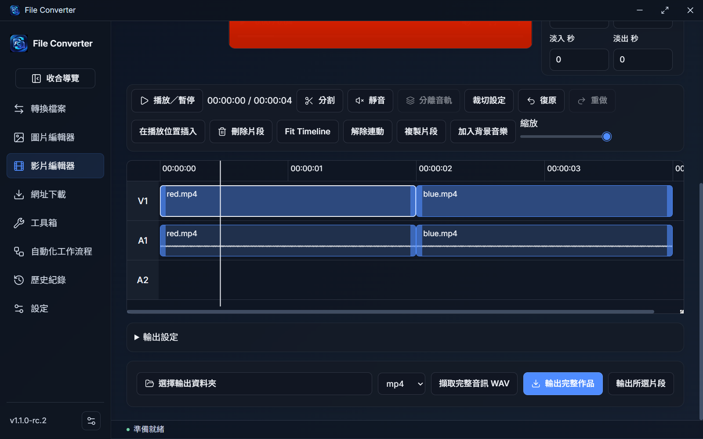
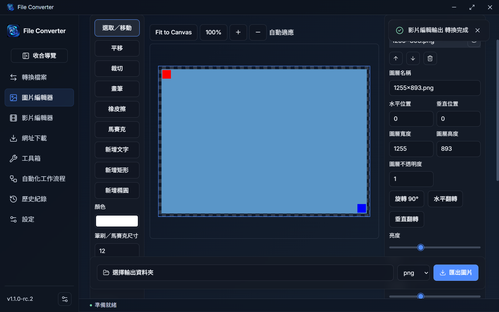
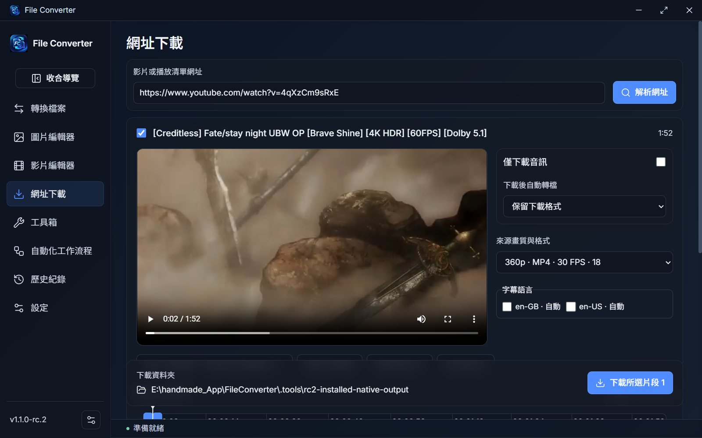

# 1.1.0-rc.2 修復紀錄

基準 a9fea6f，分支 feature/multimedia-editor。R1–R4 僅增量驗證，R5 才集中封裝；本文件的進度不代表未執行項已通過。

## R1

匯入實際含音訊的影片會建立 V1/A1 關聯片段，A2 保留給音樂。FFprobe 提供串流及時間資訊，波形以實際音訊建立並保留來源延遲。pairId／linked／videoOnly 是向下相容的 v1 專案擴充：舊影音合一專案仍有效；分軌後即使取消 V1 的 mute，renderer 也不重複輸出其音訊。預覽和匯出共用 renderer。

移動、插入、Trim、Split、複製、刪除與方向鍵移位會處理關聯片段；解除連動後可獨立操作，重新連動只使用原配對並對齊所選片段。自動分離後的手動分離按鈕停用，無音訊影片同樣停用。加入背景音樂直接送 A2。V1 的音量／靜音控制轉交原配 A1。

上方素材庫／最多 640px 預覽／可收合屬性，中間集中操作，下方預設 280px 可調高時間軸；Fit Timeline 使用實際容器寬度和專案長度，手動縮放保留。具連動提示與片段右鍵操作；小視窗屬性移至時間軸後，素材庫可收合。

增量結果：既有影片引擎 4 組通過；新增實際延遲音訊測試驗證正常音量、靜音、半音量 A2、裁切及專案往返；Node 模型測試驗證連動、拆分與無音訊來源；真實 Python service 元件測試驗證 V1/A1／波形、連動移動、同步 Split、解除／重新連動、存檔與 1920/1366/1280/960px 版面。TypeScript 檢查通過。沒有打包或重跑 305 矩陣。

交付保留事項：1.0.0-rc.1 已在本輪前依使用者明確要求刪除，無法把不存在的檔案宣稱為已保留。本輪保留現有 1.1.0-rc.1、使用者資料、Runtime 與全部 Git 歷史。

## R2

原版沒有 IFrame Player API，而是直接把 yt-dlp 的媒體 URL 交給 HTML video；因此 101/150/153 不是這個播放路徑的錯誤碼。實測使用者來源 4qXzCm9sRxE 可解析 112 秒／69 格式，但 Edge 直連 googlevideo 得到 302 後未就緒，20 秒逾時，當時沒有可取得的 MediaError 數字碼，不能宣稱「禁止嵌入」。額外來源 aqz-KE-bpKQ 回傳 206、直接播放成功。兩者皆實際播放／暫停／Seek，與時間輸入同步；非純 metadata 驗證。

加入可取消的本機預覽：經既有 yt-dlp 工作佇列下載低畫質完整來源、轉為 H264/AAC，僅透過既有 previews asset 範圍播放。明確提示會下載完整影片、顯示真實進度，不加 Cookie／登入繞過、不放寬 CSP、不載遠端 SDK。預覽不寫入歷史，離開來源會取消並移除自己的預覽及下載快取。來源真正不可用仍回報引擎錯誤，正常下載／選段控制獨立運作。提供受限 HTTP/HTTPS 原始網址開啟，以及 MediaError code/message、逾時提示與重試。

使用者來源的本機備援成功播放 112.151995 秒並 Seek；播放器寬度 640px。實際自有 HLS 引擎測試驗證低畫質 H264、預覽資源位置／清理、正常選段仍有效。既有 range-ui 的拖曳、時間輸入、多段、播放／Seek 與響應式測試通過。影片資訊／格式／下載設定放於播放器右側，時間軸與下載按鈕置下方，小視窗改直排。最終仍需在 R5 實際 Windows WebView2 候選中重測，不能把 Edge 元件結果冒充原生截圖。

## R3

移除固定 65% 顯示比例，以實際 viewport 寬高扣除安全邊距計算 Fit；viewport 高度不再由圖片高度反推，避免 ResizeObserver 回饋迴圈。圖片 stage 以 auto margin 置中，放大後仍可從左上完整捲動，不因 flex 負向置中裁掉邊界。顯示縮放不寫入專案或輸出尺寸。

新增 Fit／100%／放大縮小／百分比與游標錨點滾輪縮放。自動模式隨可視區變化更新，手動模式保留縮放；SVG 使用 getScreenCTM 的反矩陣將滑鼠座標映回圖片座標。仍沿用原有像素合成與版本化專案。

五張自製實際 PNG（1255×893、1920×1080、1080×1920、4000×3000、1000×1000）逐張驗證四邊、長寬比、視窗縮放、手動模式保留、Fit、畫筆位置、裁切位置、移動圖層、Undo 與專案重開；共 15 份 PNG/JPG/WebP 原尺寸輸出，以兩個角落色標及透明角落檢查完整內容。既有圖片引擎 4 組及圖片元件的排序／隱藏／畫筆／裁切／Undo/Redo／專案重開／200×160 RGBA 輸出均通過。未執行 Installer／Portable 封裝。

## R4

實際 App／Python service 的跨頁整合測試通過：轉檔→影片自動 V1/A1、圖片成果→原佇列、原生 drop 事件路由、真正自有 HTTP 下載完成→編輯器再建立配對、切頁保留所有片段／下載文字並暫停背景播放。背景音樂拒收無音訊素材，V1 靜音操作正確交給原配 A1。沒有新增主題色、字型或宣傳內容。Rust 增量 check 通過；最終 Windows 正常退出及 Sidecar 清理會在 R5 用實際候選再驗證。

## R5 執行與修正紀錄

本輪完整來源回歸 70 項、69 通過、1 個 PE 項等待實際包；新目錄的 305/305 格式方向通過，不沿用前輪矩陣結果。新增音訊測試以真正 PCM 取樣檢查延遲、靜音、半音量與舊專案；新本機預覽測試實際下載自有 HLS、轉 H264、檢查快取清除及正常區間下載。

由 488c9b2 的 Git export 建立獨立來源目錄，實際執行 setup-dependencies.ps1 -Offline，重新建立 venv／node_modules／vendor，使用已校驗的 Runtime archive、40 個 hash-locked wheels、npm／Cargo 快取和現有 SDK，全部還原／雜湊／無可選 AI 模組檢查通過。之後受控更新相同依賴鎖的 GUI／驗收修正；正式建置來源會記錄於最終報告。沒有進行完全無快取的網路重建，不將這項離線快取驗證冒充無快取驗證。Cargo 編譯產物另重用明確的 target 接合，並未複製原 venv 或 vendor。

真正 Tauri／Fixed WebView2 157 開發版驗證了 V1/A1／波形、完整 1255×893 圖片、指定影片的本機播放／Seek／精確區間輸出。重複網站驗證中曾遇 HTTP 403 Forbidden；前後同來源均曾成功。保留受限及成功紀錄，不加入 Cookie／登入繞過。最終包若網站受限，另外使用自有 HTTP/HLS 驗證同一原生播放／下載路徑，並分開記錄網站結果，不能宣稱受限網站已通過。

IFrame 101／150 是嵌入限制，153 是 HTTP Referer／client identity 缺失；參考 [YouTube 官方 IFrame API](https://developers.google.com/youtube/iframe_api_reference)。本程式既有路徑為 HTML media／本機轉碼，沒有 IFrame，這些碼不適用於實測的 302 逾時或 yt-dlp 403。沒有為此放寬 script/frame CSP 或在有本機 IPC 權限的頁面載入外部 SDK。

原生畫面檢查後再減少工具頁大型標頭與單一來源重複標題，讓播放器與右側設定更接近頂端；圖片 Fit／100% 移至畫布上方。選取片段匯出保留關聯 A1，PIP 新素材會選用不重疊的音訊軌。這些相關模型／元件測試亦通過；沒有因此重跑完整後端矩陣。

初次集中封裝完成後，實際 Installer 及解壓的 Portable 都通過三組修復、內容取樣與原有功能測試。Installer 上實測的直接串流錯誤為 **HTML MediaError 4**，本機備援可播放 112.151995 秒並成功輸出指定 2 秒。先前驗證中的 302 逾時與 403 也保留，不把所有失敗歸成來源禁止嵌入。聲音 RMS 與來源比值約 1.05，排除雙重原音；選取片段匯出也包含音訊。

最後另外發現帶 EXIF 旋轉的 JPEG，inspect 回報 1255×893 而顯示應為 893×1255。已先以真實 JPEG 重現，再讓匯入尺寸及縮圖都使用 ImageOps.exif_transpose；實際 PNG/JPG/WebP 匯出檢查方向與兩個角落，來源 SHA 不變。舊專案既有畫布／圖層尺寸仍照原值讀寫，不強制遷移。此修正只重做 Sidecar 與必要的 Installer／ZIP，沒有重新下載依賴或重跑 305 矩陣；最終包仍需重測 EXIF 案例。首次建置 13 組凍結測試通過；局部修正後另測方向 1 組與圖片 4 組。

安裝／移除測試以資料表語意雜湊檢查 settings／jobs／automation，並保存自己的捷徑。右鍵驗收先保存 92 個本程式專屬 verb/command keys，啟停與第二實例轉送後逐欄復原；不修改其他應用程式、預設開啟關聯或全系統檔案圖示。第一次右鍵腳本早於頁面建立，已加入就緒等待後通過，未改動產品來避過測試。

## 最終候選驗收 — 2026-11-17

最終產品來源 **765e6e45c9912813f519a7c8d75172a4e2647c06**，前端來源 783e826；之後的驗收文件／測試工具提交不代表再次編譯產品。完整來源回歸、305 矩陣、原有 GUI／核心轉換各在本輪 R5 執行一次；觀察到 EXIF 錯誤後，僅重做受影響 Sidecar／包及相關圖片、圖示、封裝、兩種實際原生修復驗證。沒有重複整套矩陣、依賴下載或每階段封裝。

| 驗證 | 本輪結果與範圍 |
|---|---|
| 完整來源回歸 | 70 項：69 通過、建置前 1 個 PE 項跳過；正式 main EXE／Sidecar／Installer 圖示另以 4 項實際資源測試通過 |
| 合法格式矩陣 | 新目錄 305/305，實際內容驗證 |
| 凍結版 | 首次 13 組編輯器／OCR／預覽測試通過；EXIF 修正後方向 1 組及圖片 4 組通過 |
| 原有 GUI | 原生 23/23，外觀持久化、佇列、轉換、歷史及視窗；沒有非預期外部請求 |
| 原有引擎 | 只含 Windows 的子程序 PATH 下 9 組實際轉換／修補；安裝／免安裝均另測圖片、Office PDF、繁中 OCR |
| 最終 Installer | 真正安裝後的 V1/A1／真波形、預覽、完整作品與帶聲音選取片段、1255×893、EXIF 893×1255、實際網站本機預覽及精確 2 秒下載均通過 |
| 最終 Portable | 從最終 ZIP 解壓後，重測相同三組修復及 EXIF，全部通過；一般無 CDP 啟動／原生視窗／正常退出、無殘留 Sidecar 通過 |
| 真正內容 | 兩種包均解碼 4 秒成片：0.5 秒紅、2.5 秒藍；聲音 RMS／來源 1.0518，排除雙重原音；所選 2 秒片段含聲音；圖片角落像素／Alpha／EXIF 方向正確；網站片段 FFprobe 2.000 秒 |
| GPU／CPU | 最終凍結引擎 CPU libx264、AMD h264_amf 實際輸出；此主機 NVIDIA／Intel 不可用，兩者明確回報並以 libx264 備援成功，非這兩種硬體的實機認證 |
| Windows／資料 | 右鍵啟停與第二實例轉送通過；原有 92 個專屬 keys 逐值恢復並再次唯讀比較；正常移除後 settings／jobs／automation 語意雜湊皆相同 |
| 封裝 | ZIP CRC、22,183 個 Runtime manifest 項目、必要引擎／模型／字型、Fixed WebView2、無 AI 模組檢查通過；Installer EXE 與 standalone 只差 Tauri 官方 bundle-type marker |
| 舊版 | 既有 1.1.0-rc.1 Installer、ZIP、EXE SHA-256 均未改變；先前已依使用者要求刪除的 1.0.0-rc.1 沒有虛報保留 |

兩種最終包對使用者影片的直連均得到 **HTML MediaError 4**；可取消的低畫質本機備援均實際播放 112.151995 秒、暫停／Seek 並輸出 1→3 秒片段成功。測試期間也曾見 HTTP 403，網站限制不屬於保證永久可用的功能；未繞過登入、Cookie 或權限。直接媒體 URL 與 HTML 播放路徑不能用 IFrame 101／150／153 解釋。

依賴還原使用乾淨 Git 來源目錄、新建 venv／node_modules／vendor，校驗官方來源鎖定版本、archive／wheel SHA，實際建置成功。使用已驗證快取、既有 Windows SDK 與編譯快取；**未進行完全無快取網路重建，也不是乾淨 Windows 作業系統驗收**。FFmpeg／FFprobe、yt-dlp／EJS、LibreOffice、Calibre、Pandoc、7-Zip、Ghostscript、Tesseract API＋eng／chi_tra、WebView2、Python 與字型都包含在包內；Git 僅保留來源／鎖檔／還原腳本。40 個 Python 明確釘選依賴及無 AI 模組檢查通過。授權文件與 build configuration 已納入包，但外部二進位完整 corresponding-source 散布閘門仍未關閉，見 [DISTRIBUTION](DISTRIBUTION.md)。

### 交付檔案與 SHA-256

根目錄 `release/`：

- `File Converter_1.1.0-rc.2_x64-setup.exe`（Installer）
- `FileConverter-1.1.0-rc.2-windows-x64-portable.zip`
- `FileConverter-1.1.0-rc.2-Portable/FileConverter.exe`（必須保留整個目錄）
- `SHA256SUMS-1.1.0-rc.2.json`、`DELIVERY-1.1.0-rc.2.json`
- `VALIDATION-1.1.0-rc.2.md`、`validation-1.1.0-rc.2/`

```text
Installer a175810d0b42abe35bc6239c5b1fe3ce441793a9e4f5b91768eab784abdc518f
ZIP       29a21df8a4e54edb5894f80ac4d129f08a896bcd960571f309b33866ed314b3f
EXE       92f32b8ef618f4d24a2854d770cbcfc20b7b01dda17287f6e838fe02a7b423d6
```

實際 Windows 原生 Tauri／Fixed WebView2 截圖（檔案挑選由測試提供路徑，IPC／佇列／引擎／播放／輸出皆真實執行）：





原始報告見 `docs/validation/rc2-summary.json` 及同目錄 `rc2-*`。包內文件是建置時快照，最終驗收文件另隨 release 交付並存入 Git，避免只因文件更新再封裝。

### 尚待外部驗收

沒有乾淨 Windows VM／第二台電腦，因此不宣稱已通過未裝開發工具的全新 OS；本機 app-local Runtime 與 system-only PATH 測試已完成。Windows 10、實體多螢幕 125/150/200% DPI、其他 NVIDIA／Intel 裝置仍需外部實機。候選未簽章，公開／客戶散布前仍需完成外部二進位完整相應來源交付及適用授權要求。這些限制不以成功編譯或模擬 DPI 冒充通過。

Git 只提交目前 `feature/multimedia-editor`；不合併 main、不建立 Tag／GitHub Release、不 Force Push。驗收提交 Hash 由最終交付紀錄與 Git HEAD 記錄，與上述產品建置來源明確區分。
