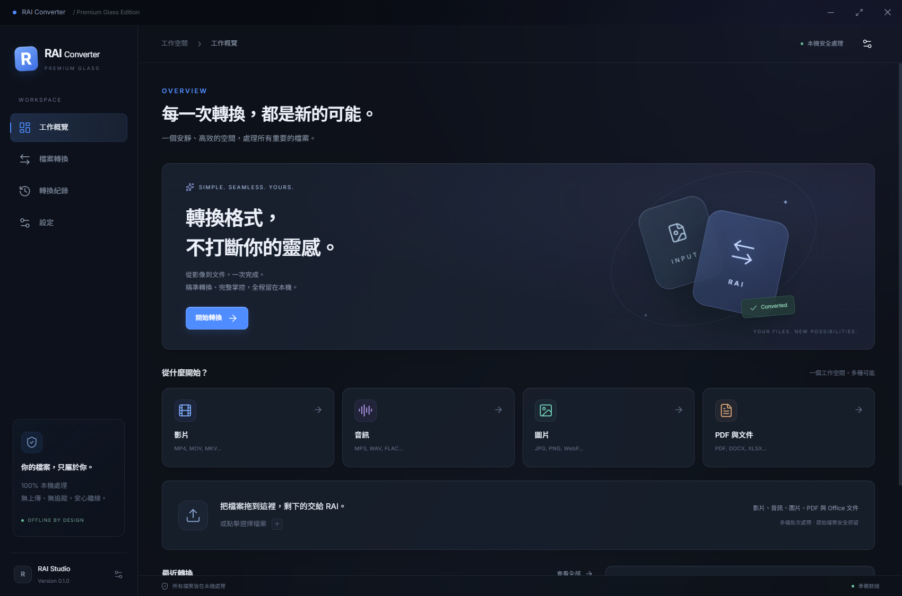
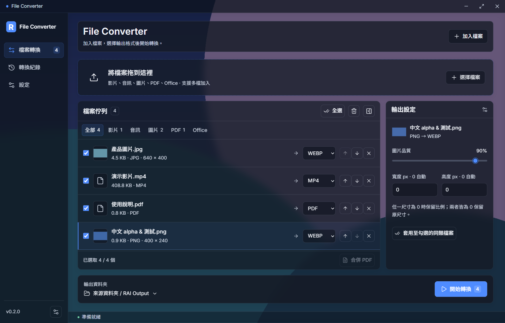
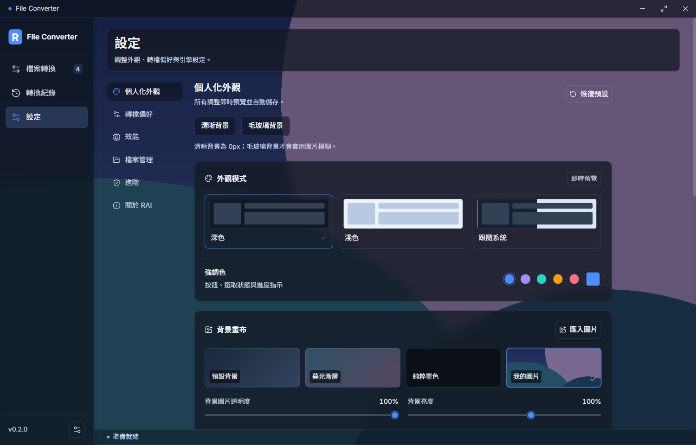
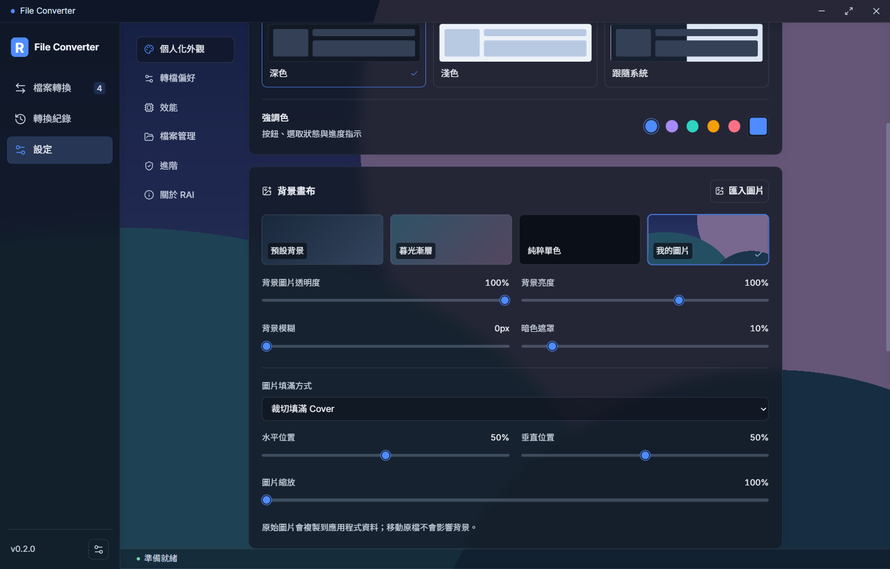
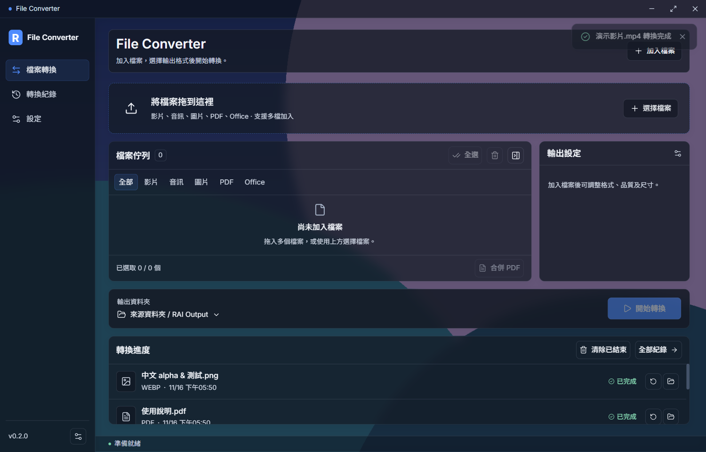

# v0.2.0 UI/UX 整改

此頁保留上一版的整改紀錄。最新 P0 0.3.0 的雙模式、工具箱、新圖示及畫面請見 [P0.md](P0.md)。

沿用原有 Tauri / React / Rust / Python 專案與轉檔架構。沒有移除影片、音訊、圖片、PDF、Office adapter、佇列、真實進度、取消、重試與歷史功能。

| 項目 | 整改前 | 整改後 |
|---|---|---|
| 首頁 | 宣傳 Banner、分類卡片、隱私宣傳與最近紀錄 | 啟動直接進入轉檔；拖入區 → 佇列 → 輸出設定 → 輸出位置／開始 → 真實進度 |
| 文字 | 多數 8–12px、低對比灰字、英文裝飾標籤 | 內文 16px、導覽 15–16px、按鈕 15–16px、標籤／次要資訊至少 14px、標題 26–28px |
| 背景清晰度 | 主工作區 20px backdrop blur 再疊卡片 blur | 主工作區明確 filter:none、backdrop-filter:none；只有局部玻璃元件模糊 |
| 背景匯入 | RGB WebP quality=92 有損重編碼 | 原尺寸、依 EXIF 方向、保留 alpha 的無損 WebP；PNG 像素保真測試通過 |
| 背景設定 | 分散參數，缺少明確清晰模式 | 匯入預設 0px；「清晰背景」與「毛玻璃背景」預設；圖片透明度、亮度、blur、遮罩及面板透明度獨立 |
| 轉檔參數 | 檔案頁另行進入、右側大預覽 | 首頁直接顯示檔案／合法格式；右側輸出設定可收合，參數區單獨捲動 |
| 小視窗 | 極小字與大量裝飾、焦點可能推動外層視窗 | 不縮小字體；窄版導覽收為圖示；只讓內容面板捲動，開始按鈕在短視窗固定可見 |
| 通知 | 多個通知堆疊可能遮住開始按鈕 | 只顯示最新通知、放在右上方；所有結果仍保留在佇列／歷史 |

背景透明度只作用於圖片圖層，材質 alpha 只作用於面板背景；文字、圖示與按鈕沒有套用父層 opacity。外觀 schema version 2 遷移舊版預設，同時保留使用者的圖片、自訂色彩與參數。舊的主工作區 blur 值不再生效，設定頁亦不再提供這個無效滑桿。

## 實際畫面

下列為實際 WebView2 桌面應用程式截圖，非設計稿。整改後使用自行產生的本機測試背景與檔案，不把使用者的個人背景放進專案文件。

整改前首頁：

整改後轉檔首頁：

整改後個人化設定：

背景獨立參數與 0px 清晰模式：

實際四檔混合批次完成（圖片、影片、PDF）：

## 驗證方式與範圍

- 原始及凍結引擎各 17 項整合測試：圖片／影音各容器／PDF、原檔保護、中文特殊路徑、250 筆匯入、失敗隔離與程序清理。
- Node assertions：外觀預設、舊設定遷移、使用者自訂參數保留、清晰／毛玻璃配置。
- 13 組真實原生 GUI 整合測試：字級、背景獨立控制、材質、設定重載、批次選取與排序、實際轉檔、歷史重試、最大化還原、不同尺寸及 DPI 模擬。
- 1500×960 等測試在未捲動的工作區檢查上傳區、檔案佇列、輸出資料夾與開始按鈕的位置；小視窗使用面板內捲動，短視窗工具列固定可見。
- DPI 為 WebView2 renderer 的 125%、150%、200% 尺寸模擬，仍不等同實體多螢幕跨 DPI 驗收。
- 原生選檔對話框回傳值由測試檔案替代；檢查、SQLite、轉檔引擎及輸出檔均為真實流程。沒有新增模擬進度。

Office adapter 沿用原有 LibreOffice 依賴檢測；未安裝 LibreOffice 時會明確標示不可用。完整 Office 格式組合、Windows 10 與乾淨 VM 安裝仍屬待環境驗收項目，詳見 VALIDATION.md。
